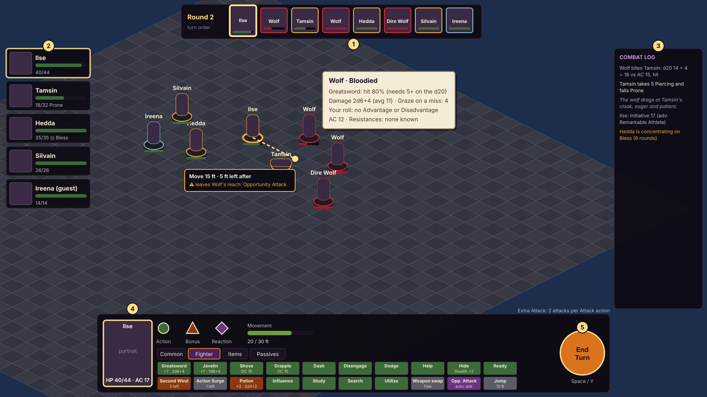
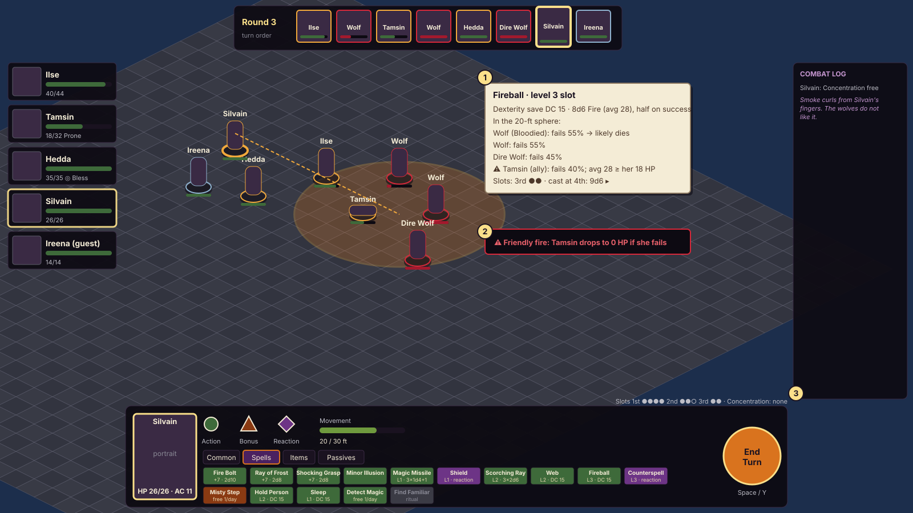
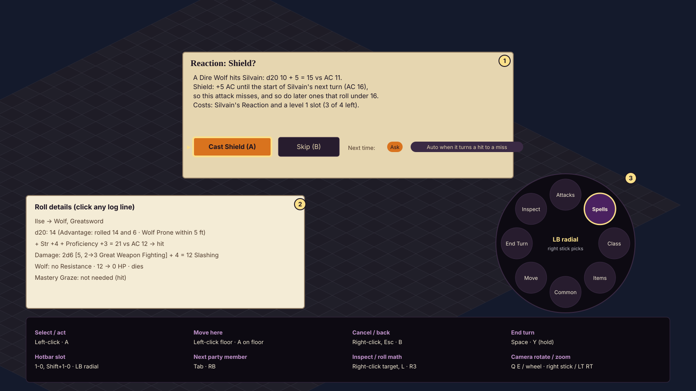

# Combat view and controls

Status: **approved by the owner 2026-10-06 ("Looks good")** (added at the owner's request) · Owner role: UI/UX ·
Plan §5.3 · Built in Phase 2 · Layout inspired by Baldur's Gate 3's turn-based combat screen (initiative strip on
top, party on the left, hotbar and End Turn at the bottom, log on the right), drawn in our palette and style.

## What this screen must do

- Make a 2024 turn readable at a glance: whose turn it is, what they have left (Action, Bonus Action, Reaction,
  movement), what each option will do, and the odds, before the player commits.
- Keep the player in charge of every party member and guest (plan pillar 2). The game never acts for them; it only
  asks (reaction prompts) or follows rules the player set ("auto when it turns a hit to a miss").
- Show the dice and the math for every roll (plan §5.3 "visible dice and math").

## Layout (`cb_01_combat_view`)

1. **Initiative strip** (top center): round number and portraits in turn order; the active creature is larger with a
   candle frame; enemies have red frames, the party gold, guests moonlight blue; a thin HP bar under each (enemies
   show Bloodied and dead states, not exact HP). Hover a portrait to highlight the creature on the field. A long
   order scrolls sideways inside its panel (see "A long turn order" below).
2. **Party frames** (left): the four party members and any guest, with HP bars, conditions as named chips (Prone,
   Poisoned, Bless ◎ for Concentration) and the level-up badge. Click or Tab to switch the controlled character on
   their turn or to inspect them otherwise.
3. **Combat log** (right): every roll as one readable line (`D20Test.describe()`, `DamageResult.describe()`),
   Narrator lines in italics (plan §5.7, rare and short in combat), warnings in amber. Click a line for the full
   math (see cb_03).
4. **Hotbar** (bottom): the active character's portrait with HP and AC; the action economy as shapes plus words
   (Action ●, Bonus Action ▲, Reaction ◆; greyed when spent) and a movement bar ("20 / 30 ft"); tabs (Common,
   class name or Spells, Items, Passives); slots colored by what they cost (Action green, Bonus Action ember,
   Reaction plum, free slate) and labelled with their numbers ("Greatsword +7 · 2d6+4", "Second Wind 3 left").
   Every PHB action is on Common: Attack, Dash, Disengage, Dodge, Help, Hide, Influence, Magic, Ready, Search,
   Study, Utilize, plus Grapple and Shove (Unarmed Strike options) and Jump. Extra Attack shows "2 attacks per
   Attack action".
   **Haste** (2024): a hasted creature's weapon slots (and a click on a foe) make its additional action's one attack
   once the Attack action and its attacks are spent: the slot reads "free", with "Haste" beside its numbers, so nobody
   has to look for the separate "Haste:" slots (Dash, Disengage, Hide, and an attack to make before the Action).
5. **End Turn**: a large round button (Space, or hold Y). If the character still has their Action, the first press
   shows "End turn with your Action unused?". Leftover movement doesn't ask (owner feedback 2026-10-06).
   **Undo move** under it (Ctrl+Z) takes back the last move while nothing came of it (no dice, no reaction, nothing
   new seen), one move at a time back to the last thing that wasn't a move (`Encounter.undo_move`).

On the field: nothing is lit until the pointer asks (owner 2026-10-06: the always-on blue squares of where a creature
could move were noise). Hovering the floor shows the walk as a dotted trail to a ring where the creature would stop,
with feet used and left; the ring turns red and the tooltip warns before a step that provokes an Opportunity Attack
("leaves Wolf's reach"), naming the creature. A square out of reach shows only a pale ring and why. Hovering
a creature shows the **target tooltip**: hit chance and the d20 needed, damage with average, mastery effects (Graze
on a miss), Advantage/Disadvantage with their sources, cover, and what the party knows of its defenses.

## Targeting and areas (`cb_02_targeting`)

- Spells and area attacks preview their template on the grid (sphere, cone, cube, line, emanation) from the spell
  data, with every creature inside listed: save and DC, the chance each fails, expected damage, and whether it would
  likely drop. A creature a spell "of your choice" leaves out (Slow's allies, Word of Radiance's) shows as not affected.
- **An area placed at a point is centred on the pointer** (owner, 2026-10-13: "the pointer should be at the middle of
  the area"; `TargetPicker.aim`): a Sphere or Cylinder on the grid intersection nearest it (the DMG's grid rule), a
  Cube with its middle there and its point of origin on the face toward the caster, where its range is measured (an odd
  size, such as 15 ft, sits on the middle of the square pointed at), an Emanation from a point on the square pointed
  at. Pointing at a creature's figure aims at the creature, not the floor behind it. No cursor ring is drawn while
  placing it: the outline is the cursor.
- **An area aimed from the caster points at the pointer, at any angle** (owner, 2026-10-12 for Lines, 2026-10-18 for
  the rest: "For AoE spells like cone of cold, we should be able to aim them freely (not have it locked to certain
  boxes)"; `CombatView._aim_dir`): a Cone (Burning Hands, Cone of Cold, a Breath Weapon), a Line (Lightning Bolt) or
  Thunderwave's Cube turns with the aim, settling on a row, column or diagonal within 2° of one; a cone or line starts
  where the aim leaves the caster's space. A cone takes every square at least a quarter inside its triangle, a line
  every square at least half inside it, a cube every square whose middle is inside it (`CombatGrid.area_cells`); the
  outline drawn is that shape and the creatures listed are the ones it takes. Foes' cones point straight at the creature
  they aim at the same way (owner, 2026-10-18: "Opponents can free aim too").
- **A creature in another shape wears it** (owner, 2026-10-13: "When an enemy or character is polymorphed, their
  sprite should reflect their transformed shape"): a Polymorph's, True Polymorph's or Wild Shape's Beast is drawn with
  that Beast's own sprite, height and base, facing the way the creature faced, its name, health bar and portrait the
  Beast's; when the shape ends (the spell ends, its Temporary Hit Points run out, it drops, the caster's Concentration
  breaks) the creature's own figure comes back. A hero's or guest's own figure waits hidden meanwhile, and walks on
  after the fight even if the shape still holds.
- **Up to so many creatures of your choice in the area** (Slow's six, Mass Cure Wounds' six): once the area is
  placed, the creatures in it can be picked (`TargetPicker` "choose" step), with the ones it would take lit to start
  (Slow: its foes in it, the hardest hitting first; Mass Cure Wounds: its side's most hurt). A click on a creature adds
  or drops it, up to the spell's number; a click on the floor or Enter casts. Backspace or right-click places it again.
  With no one in the area it goes off as placed. The AI and the test autopilot take the ones lit by default.
- **Up to so many enemies of your choice** (Steel Wind Strike's five): choosing the spell lights the foes in range; a
  click (A, or the next-target key to move between them) adds or drops one, a friend is refused ("Choose an enemy"),
  and a click on the fifth, or Enter (Y), casts with however many are picked. A melee spell attack goes at each, once.
- **Friendly fire** is called out in red with what happens to the ally; it never blocks (the player decides).
- **Walls are drawn** (Wall of Fire, Wind Wall, Wall of Stone, Ice and Force, Wall of Thorns, Blade Barrier, Prismatic
  Wall): click the square where the wall begins, then squares touching the last one (a click further along a
  straight line adds the squares between); the floor shows the squares drawn and the next one (a red ring and the
  reason when it can't go there), the tooltip the length used and who stands in the wall. Backspace or right-click
  takes back the last square; Enter or a click on the last square finishes. A Wall of Fire then shows the side that
  would burn under the pointer: click the side. A ring, globe or dome (right-click menu) is placed at a point.
- **Second picks** (addons/dnd_core/world/combat/target_picker.gd): Commander's Strike's ally, then the creature it attacks (Enter: its
  best target); Crown of Madness's target, then the creature it must attack (Enter, or a click on the crowned creature:
  no one), and the same pick on the keep-control action; after a Maneuvering Attack hit, the ally that moves (skipped
  when only one can) and its square, with the path and any other enemy's Opportunity Attack shown. Backspace or
  right-click goes back a step; Esc cancels (and passes on the maneuver's move).
- **Dimension Door and Thunder Step** (a teleport that can take one willing creature along): Thunder Step's hover shows the boom's edge round the space you
  would leave and, in the area panel, who it would catch and their Con saves (friends too); once the square is picked, the allies
  who could come (willing, within 5 ft, and your size or smaller for Thunder Step) light green: a click (A, or the next-target key to move between them)
  brings one, Enter (Y) or a click on the landing square goes alone, Backspace or right-click picks another square, Esc cancels. With
  nobody able to come it casts at once.
- **Sculpt Spells** (an Evoker's Evocation spell with the caster or its allies caught in it): once the spell is aimed,
  the creatures in it show green when shielded and red when not, starting from the caster and its allies nearest it,
  up to 1 + the spell's level; a click (A, or the next-target key to move between them) shields one or takes it back,
  Enter (Y) casts. Backspace or right-click aims again; a spell from the caster with no aim (Thunderclap) asks as soon
  as it's chosen, and Esc cancels it.
- **Invisible foes are off the map** (owner, 2026-10-13: "Creatures that go invisible should disappear from the map
  unless the player character targeting them has invisibility"): while the hero whose turn it is can't see it (See
  Invisibility, Truesight or Blindsight in range, Robe of Eyes, Lantern of Revealing; through a foe's turn, the hero who
  had the last one) an Invisible foe's figure, ring and bar, its portrait in the turn order and its row in an area's preview are gone, the pointer and the next-target key
  skip its square, the camera stays put for its turn and no number floats over it; it's back the moment the turn passes to a hero
  who sees it or the invisibility ends. Each hero can only target what they see themselves ("You can't see X" on the
  hotbar), which is what the map shows on their turn, though an area still catches it. An Invisible hero stays on the player's map drawn half there.
- Upcasting: the slot pips beside the tooltip pick the slot level and update the numbers (Fireball 8d6 → 9d6).
- Concentration: casting a second Concentration spell warns that the first one ends, naming it.
- **Drop Concentration** (owner, 2026-10-17: end it at will): while a creature holds a spell, a free slot on its Common
  tab, named for the spell, lets go of it. It asks "Stop concentrating on ...?" first (Enter or A drops it, Esc or B
  keeps it; Space doesn't answer it) and costs no Action, Bonus Action, Reaction or movement; the spell ends with
  everything it keeps going. On the creature's own turn, as every slot (deviations.md).

## Reactions, roll details and the controller (`cb_03_reactions_and_controls`)

1. **Reaction prompt**: the trigger in plain words with the numbers ("hits Silvain: 15 vs AC 11"), what the reaction
   would change ("AC 16, so this attack misses"), its cost, and Cast / Skip. "Next time" sets a per-character rule
   for that reaction: Ask (default), Never, or an automatic condition such as "auto when it turns a hit to a miss"
   (plan §5.3: a rule the player sets, not AI judgment). Opportunity Attacks, Shield, Counterspell, Uncanny Dodge,
   Parry and Riposte all use this prompt. A foe's Counterspell at a spell of the party's asks "Counterspell?" of each hero
   who could answer it (the text gives each side's save and its odds; the slot is a pick when there are several, and
   Automatic still asks then); a Counterspell of theirs can be Counterspelled in turn, and the combat log tells each step
   and how the chain resolved, last Counterspell first (combat/spell_counters.gd).
2. **Roll details**: any log line opens the whole calculation, with dice, Advantage sources, every modifier, damage
   dice before and after Great Weapon Fighting, Resistances, and mastery effects.
3. **Controller**: LB opens a radial menu (Attacks, Spells, Class, Items, Common, Move, End Turn, Inspect); the right
   stick picks, A confirms. The bottom panel lists the full mouse, keyboard and controller map.

## States

| State | What the player sees |
|---|---|
| Party member's turn | hotbar active; portrait enlarged in the strip; camera eases to them |
| Enemy or neutral turn | hotbar dimmed with "Wolf's turn"; the log narrates; reactions can still prompt |
| Out of an action type | its shape greyed; slots that need it greyed with the reason ("Bonus Action used") |
| Slot unavailable | greyed with why ("No level 3 slots left", "Needs a free hand", "Incapacitated") |
| Movement preview | dotted path to a ring, feet used and left, Opportunity Attack warnings (red ring), difficult terrain shown as doubled cost |
| Targeting | template on the grid, creatures listed with chances; Esc/B cancels |
| Reaction pending | modal prompt; the turn pauses; a timer is never used |
| Character at 0 HP | frame greyed; on their turn the hotbar shows the Death Saving Throw button and the tally |
| Combat start | an opening beat before the first turn (see below); surprise explained per creature |
| Combat end | the combat HUD fades out and the exploring HUD back in; survivors who aren't the party fade away |

## Into a fight and out again

Owner 2026-10-06: the switch into combat felt abrupt (the party's figures were swapped for fresh ones facing the
camera, foes popped in off screen, the HUD cut, the floor lit up). A fight now opens with a short beat
(`CombatView.INTRO_TIME`) while the rules are already running:

- As it breaks out the picture streaks toward the party, drains of colour and flashes for three quarters of a second
  (Visual Polish Plan 3, `ScreenPulse` "engage": Octopath's encounter swirl done in place, nobody moves). Critical
  hits, killing blows and big spells landing get a shorter pulse at the creature or spot hit on top of CombatImpact's
  freeze and push-in ("crit", "kill", "spell"). It plays in real time (slow motion doesn't hold it), fast combat
  shortens it, it never runs headless, and it draws over the world and under the HUD and menus. It costs about 1 ms
  a frame at 3440 x 1440 while it plays and nothing otherwise (pulse_capture prints it).
  `make capture SCENE=res://tools/capture/pulse_capture.tscn NAME=pulse FRAMES=10` holds each near its peak.
- The party and guests keep the figures they were exploring with (mid-step, facing, the lit lantern) and turn to the
  nearest foe as their step lands; the foes fade in where they stand, nearest first, facing the party.
- The camera eases to the middle of the fight and pulls out until everyone shows inside the HUD, so the player sees
  what they face; the first turn brings it back to the player's zoom on whoever acts first.
- The exploring HUD fades out and the combat HUD fades up (`LayerFade`); "Roll Initiative" holds over the field, then
  "Round 1" as the first turn starts. The combat music crossfades in as before.

At the end the party's figures go back to exploring where they stand, the combat HUD fades out and the exploring HUD
back in. `make capture SCENE=res://tools/capture/combat_transition.tscn LOCATION=<id> ENCOUNTER=<id>` shoots both ways
as frames and contact sheets.

## Engine hooks

Phase 1 already provides the numbers and text: `WeaponProfile` (attack and damage breakdowns, crit range, mastery),
`AttackResolver.weapon_attack` (roll, Advantage sources, Critical Hits, Prone and Paralyzed targets, damage through
defenses), `Character.spell_preview` (spell dice, bonuses, save DC), `D20Test.describe()` and
`DamageResult.describe()` for the log, `Creature.d20_sources` for Advantage explanations, and conditions and effects
for the chips. Phase 2 adds the turn manager (initiative, action economy), the grid, line of sight and cover, area
templates, hit-chance math, the reaction system and the hotbar's action catalog.

## Acceptance (Phase 2)

- A scripted fight (the plan's wolves-and-zombies arena) is playable with mouse and keyboard only and with the
  controller only.
- Every hotbar slot, tooltip and log line shows numbers that match the rules engine.
- No party member ever acts without the player choosing it or a rule the player set.

## Built (Phase 2)

`make arena` opens the screen with the arena fight; `ui/combat/` draws it from `combat/action_catalog.gd`. Captures:
`captures/arena_p2_1_move.png` (movement preview), `_2_attack.png` (target tooltip), `_3_area.png` (Thunderwave
template), `_5_end.png` (the end of a fight). Where the build differs from the wireframes, and why:

- **Jump** isn't a hotbar slot: in 2024 it's part of movement, and the arena has no gaps. It arrives with Phase 3
  levels.
- **Ready** holds an attack for an enemy coming into reach; readied spells come later (deviations.md).
  **Influence** is greyed with the reason ("Wolves and the walking dead can't be reasoned with").
- **Level-up badge**: no experience is earned in the arena, so it never shows.
- **Controller** (docs/ui/controller.md, addons/dnd_core/world/combat/pad_combat.gd): the radial menu (hold LB, aim with the right
  stick) is in; inside a tab, LT/RT step through the slots and RB uses one, D-pad up/down change the tab and
  left/right the spell slot, and the left stick moves a square cursor that A confirms, with the camera following it.
  The right stick turns and zooms the camera when the radial isn't open. X jumps to the next target, Y ends the turn
  (while picking targets, it casts with those picked), L3 takes back the last move, R3 opens the square's menu at the
  cursor, A rolls a dying hero's Death Saving Throw, Start opens the menu and View the controls card (F1 on the
  keyboard), shown instead of a permanent bottom panel to keep the field clear. The reaction prompt and the end-turn
  check take the pad alone while they show, so their choices (the "Next time" rule, the targets) can be reached.
- **Names on the field** show for the active creature and the one under the cursor only, so a crowded fight stays
  readable; conditions and the health bar always show.
- **Heroic Inspiration** uses the reaction prompt after a missed attack roll ("Spend Heroic Inspiration to reroll?").

- **Combat log** minimizes to its title bar (the – button or L), which then shows the latest line (owner request).
- **Damage and healing numbers** stay over the creature for about 2.5 seconds (owner request); every Hit Point lost
  comes with a `damage` event, so a trap's damage floats like a blow's (FloatText, addons/dnd_core/world/combat/fx/float_text.gd, which
  a trap outside a fight uses too).
- **Right-click any hotbar slot** (weapon, spell, ability, action) for a menu: Info (the full details: attack and
  damage breakdowns, properties and mastery, or a spell's level, school, casting time, range, components, duration,
  save DC or attack bonus, dice, upcasting and its text), Use, and for spells "Cast at level N" for each slot level
  available (owner request).
- **Spell slots** left by level show on the hotbar as pips ("1st ●●●○ 2nd ●●") for casters (owner request).

Owner sign-off on the built screen: **approved 2026-10-06** with the changes above (P2-09).

## One slot per idea (Combat HUD plan, owner 2026-10-09)

The owner found the weapon attacks and the class tabs cluttered and pointed at Baldur's Gate 3. The audit and the
rest of the plan: the vault note Combat HUD Plan.md.

- **Weapons in hand** (deviations.md, Weapon sets): only the weapons in hand and the second set attack; the second
  set's say "set II", and **Swap weapons** on Common takes that set in hand (free). The pack's spares aren't listed.
- **Rules as toggles**: each Ask / Automatic / Off rule (Divine Smite, Knock Out, Heroic Inspiration, Shadow Martyr,
  Song of Defense's slot levels...) is one slot on the **Reactions** tab, its mode in colour (Ask gilt, Automatic green,
  Off grey) with a pip per mode; a click steps to the next mode, a right-click picks one, on any turn (nothing is
  spent). `ActionCatalog.slots` folds the modes; `CombatView._choose` sets them for whoever the hotbar shows.
  Repelling Blast's push and Grasp of Hadar's pull aren't reactions: their On / Off switches work the same way from the
  **Warlock** tab (Ashwin, 2026-10-13; `class_tab` in Reactions.configurable_policies), one of the two on at a time.
- **Containers**: variants of one action share a slot with a gilt corner (Shove, Cunning, Divine Spark, Haste, Open
  Hand, Cunning Strike, Portent, a spell's other castings, Command's words); a click, its number key or RB opens the
  choices at the slot, each greyed with its reason; a right-click adds the Hotbar choices for the whole slot.
- **Armed riders and smites** glow (a bright edge on a warmer face) instead of a ✓ in the name.
- **Out of the way**: Influence and Utilize show only when they can be used, Stabilize only while someone is dying.

Readable at a glance (branch `hud-look`):

- **An icon on every slot**: common actions and class abilities have tiles of their own (art/icons.json "features",
  `make icons KIND=features`; an ability without one shows the rune), containers their name's or first choice's.
- **The cost as a shape** in each slot's top right corner (● Action, ▲ Bonus Action, ◆ Reaction, a dash for
  movement, a ring for free); pointing at a slot rings the economy shape it would spend.
- **Extra Attack as pips** beside the Action: all of them until the Attack action starts, then the ones left.
- **The resource row** on the bar's top edge: spell slots by level, then the hero's own resources (Second Wind, Action
  Surge, Channel Divinity, Lay On Hands, Focus Points...) as pips, or left / most past ten; what doesn't fit folds into
  a "+N" that names the rest.
- **The weapon sets on the portrait**: what's in hand, the other set below it, dimmer; a click swaps (free).
- **The odds over the foe**: pointing an attack at a creature puts its hit chance in large figures over its head
  (green, gold or rose by the odds; edged for Advantage or Disadvantage) with the damage a hit does; the full math
  stays in the tooltip.
- **The reaction prompt** opens bottom right, above the hotbar, growing upward, so who's hitting whom stays in view
  (UI QA, 2026-10-09).

## Shared party turns (owner 2026-10-09, after Baldur's Gate 3)

Heroes next to each other in the turn order act together (deviations.md). In the turn order the heroes who can still
take theirs are edged green and the ones done dimmed; their party frames say **Ready**; the hotbar's note names them
("Shared turn · Godrick and Thistle ready (Tab or a portrait)"). A click on a ready hero's frame or portrait, Tab or the
radial's Inspect takes control of them; End Turn ends only the hero in control, and the next ready one takes over.
Settings, Game, **Party turns**: Shared (the default) or One at a time.

## Filters and one list (Ashwin's mix, 2026-10-09)

Asked to choose between the tabs and Baldur's Gate 3's PC bar (a mock-up, tools/capture/hotbar_mockup_capture.tscn),
the owner picked a mix: BG3's sidebar of filters, our icon-and-name slots. The filters run down the left of the slots
(All, then the hero's tabs: Common, the class's, Spells, Items, Reactions, Passives, and Favourites and Hidden when
used); **All** is the default and lists the starred actions, Common, the class's, Spells (a section a level: Cantrips,
Level 1, Level 2..., as on the Spells filter) and Items one section after another, each section's name on a gilt rule
above its rows. Six slots to a row; the
list scrolls past two and a half rows. D-pad up and down (or the tab keys) step through the filters. A long name over
the portrait is cut with an ellipsis so the bar never reaches End Turn.

## Examine card (owner pick 2026-10-09, after Baldur's Gate 3)

Right-click a creature (its square's menu: **Examine**; on another creature's turn the card opens straight away) for
its card: portrait, name and what it is (size, type and CR; a hero's level and classes), a line about it, then
Condition (a foe shows only whether it's Bloodied, as its bar does; a friend its Hit Points), AC and Speed, what's on it
(conditions, Concentration, spells), its Defenses and Abilities once the party has studied its kind (else "Unknown:
Study it"), legendary actions left, and the odds of the hero's best attack on it. `ActionCatalog.examine` builds it;
`CombatHud.show_examine` draws it where the roll details open; a click, Esc or B closes it.

## Jump and Throw with arcs (owner pick 2026-10-09, after Baldur's Gate 3)

**Long Jump** sits on Common (its distance in the slot: "up to 15 ft"); aimed, it draws its flight as gilt beads in an
arc from the hero to the square pointed at, a ring where it lands (red beads and ring where it can't), and the tooltip
gives the feet it costs and what's left. Everything thrown shares one **Throw** container (a thrown weapon in hand or
set II, a chair or crate within reach); aimed at a creature, the throw's arc runs from the thrower to it beside the odds
over its head. The Jump spell's leap shows the same arc.

## Tactical camera (owner pick 2026-10-09, after Baldur's Gate 3)

**O** (Settings, Keys: "Tactical camera (from above)") eases the camera to a steeper view from further back
(CameraRig.tactical: 66 degrees down instead of 40, 1.45 times as far), to plan a fight from above; O again eases it
back. It works exploring too. Rotation, zoom and the combat moments' shots work as before on top of it.

## Controller fights: Bar or Wheels (owner pick 2026-10-09, after Baldur's Gate 3 on console)

Settings, Game, **Controller fights**: Bar (today's: hold LB for a wheel of tabs, LT/RT/RB step and use the hotbar) or
Wheels (hold LB for a wheel of the actions themselves: the hotbar filter's slots, icon and name, ten to a page, the last
wedge Tactical view; the D-pad's up and down change the filter and left and right the page; release on a wedge to use
it, a container opening its choices, a rule stepping on). Both wheels carry the tactical camera, the pad's way to it.

## Dice moments (owner 2026-10-09)

When a hero makes a saving throw in a fight (a death save included), the dice lane's big emerald d20 (`DiceRoll`,
addons/dnd_core/ui/dice/dice_roll.gd) rolls it before the action's effects play: `CombatView._dice_moments` at the start of
`_play_events`, one roll after another, from the heroes' d20 events (`Creature.roll_d20` logs each roll's kind and
test). Foes' saves and attack rolls don't get it (owner, 01:27). Any press skips a roll; fast combat plays it quicker.

## A cantrip in place of an attack (owner, 2026-10-12)

A hero who can cast a cantrip in place of one attack of the Attack action (a Bladesinger's Extra Attack, War Magic, a
feature's attack_cantrip recipe) casts it that way from the cantrip's own Spells-tab slot: its cost mark reads as an
attack, its line starts "Attack cantrip" (short enough for the slot), and it starts the Attack action or uses an attack
left, so the weapon attacks follow (`ActionCatalog._as_attack_cantrip`). The separate "Cantrip attack" slots on the
class tab are gone.

## A square too far (owner, 2026-10-12)

Pointing at a square further than the movement left shows the walk as far toward it as the movement goes: the dotted
trail to a ring where it would stop, and "Move 30 ft toward there · 0 ft left after" (the square's menu: "Move toward
here"); a click walks it, with the usual path rules (Difficult Terrain doubles, Opportunity Attack warnings on the
partial walk). Only a square with no way there at all, or no movement left, still says why not
(`EncounterMovement.stop_toward`; `ActionCatalog.move_preview`'s `dest` and `partial`).

## Walking up to strike (owner, 2026-10-12)

With a melee weapon in the main hand (a Psychic Blade or a beast's bite counts; a bow there doesn't), a click on a foe
the weapon can't reach from here but the movement left can walks the hero up and swings, like Baldur's Gate 3. The
hover draws the walk (the trail and a ring, red when it provokes) with "Walk 20 ft up, then attack · 10 ft left after"
over the usual attack lines, and the odds over the foe are read from the square it will strike from: the cheapest free
square in reach, and of those that cost the same, the one whose way there provokes the fewest Opportunity Attacks
(`ActionCatalog.melee_approach`). A foe beyond the movement left still takes a ranged attack if one reaches, or says
it's out of reach. The blow waits for the walk: a reaction prompt on the way, or a walk cut short, leaves the turn to
the player (`CombatView._walk_and_strike`, `_strike_after`).

Every walk now takes, of the cheapest ways to its square, the one that leaves foes' reach the fewest times
(`EncounterMovement.safe_path`), for the heroes and the foes alike; the trail on hover is the way it walks.

## Flanking and shared squares (owner, 2026-10-12)

Flanking (the 2024 DMG's optional rule, docs/rules/deviations.md) shows where every Advantage does: "Advantage:
Flanking" in the attack's lines and the green edge on the odds over the foe (`EncounterAttacks.flanks`). The walk up to
strike prefers, of the equally cheap and equally safe squares, the one with the best odds, so it walks round to the far
side of a foe an ally is already beside. Settings, Game, Flanking turns it off (`GameSettings.flanking`, read into
`Encounter.flanking` every turn like Party turns).

A hero may end a move in an ally's space (Move here works on an ally's square; the walk up prefers an empty one). Two
figures on one square stand side by side as the camera looks (`CombatView._share_offset`), and step back to the
centre when one leaves (`_settle_shared`, after each batch of events).

## Looking along the turn order (owner, 2026-10-12)

A click on a portrait in the turn order sends the camera gliding over to that creature, hero or foe, and lights its
figure (`CombatHud.focus_requested`, `CombatView._focus_on`; the rig eases after what it follows). A hero sharing the
turn still takes the turn on a click, and the camera goes along. The next turn, an action, the camera keys or the pad's
cursor take the camera on from there; a creature nobody can see isn't shown. On a pad, Next target (X) while the radial
is held steps the camera along the order, one creature a press, the cursor going too (`_look_along_order`); a line under
the wheel names the button; the right bumper (RB) with the radial held steps back along it (`_look_along_order(-1)`).
The creature the camera went to is ringed in white in the order (`CombatHud.look_at`) until the next turn.

## A long turn order (owner, 2026-10-14)

When the portraits are wider than their panel (13 or more at 1600 px) the order scrolls sideways instead of running
past the window (`TurnStrip`, addons/dnd_core/ui/combat/turn_strip.gd; the cards are still `CombatHud._strip`'s children). At the start
of the fight and at each new turn the row glides to put the card whose turn it is in the middle, once per turn: a
refresh within the turn (a hit point lost, a condition) never moves it. Scrolling by hand holds the row where it was put
until the next turn: the mouse wheel or a trackpad over it, a touch drag, or the arrows at its ends; on a pad, LB held
with X / RB looks on and back along the order and each creature in turn is brought into view. A fade with an arrow
marks an end with more beyond it, with how many portraits are wholly out of sight that way. Nothing changes while every
portrait fits: no fades, no arrows, and the wheel still zooms the camera. The test is tests/unit/test_turn_strip.gd.

## Moving Hex and Hunter's Mark (owner question, 2026-10-12)

Once the creature Hex or Hunter's Mark is on drops to 0 Hit Points (or is gone), "Move Hex" / "Move Hunter's Mark"
shows on the Spells tab: a Bonus Action on a later turn, no slot, the same Concentration. It picks the new creature
with the usual target picker (on a pad, the slot like any other); Hunter's Mark needs one the caster can see. Hex's
curse on the chosen ability's checks goes with it (`SpellSustained` move_mark). Until the target drops the slot stays
off the bar (`waiting`). A foe the AI plays moves its mark to the nearest foe it can see (`AiBrain._move_mark`).

## Hiding the action bar (owner, 2026-10-12)

The ▾ at the bar's top right (or H; on a pad, Y while the radial is held) hides the action bar down to a slim strip on
the bottom edge: the hero's name, the Action, Bonus Action and Reaction shapes, movement, the turn note and the ▴ that
brings it back. End Turn and Undo move stay where they are. It stays hidden from turn to turn, and fight to fight for
the session, until the player shows it, or something needs them in it: a prompt, a death save, a step through the
slots or the tabs (`CombatHud.toggle_actions`, `show_actions`).

## An area spell's saves at the top right (owner, 2026-10-12)

While an area spell is aimed, its saves leave the pointer for a panel at the top right (the owner first said top left,
then "I meant top right corner"): just left of the combat log under the turn order, or in the corner under the log when
the log is minimized (`CombatHud.show_area_saves`, `_place_area_panel`). It shows the spell and slot level, the save and its DC, then every creature the
area catches, friends first, each with its portrait, friend or foe, its chance to save, the damage it can expect and
whether it may drop. Anyone Sculpt Spells would shield shows as safe (the caster, then the nearest allies, as the picks
start), and drops out of the friendly-fire warning. It lists eight, then "+N more", so it never runs into the hotbar,
and it follows the area as it moves, the pad's cursor included. By the pointer only a count stays ("5 in the area
(1 friend)"). The numbers come from `ActionCatalog.spell_preview`'s creatures (`save_chance`, `damage`, `drops`,
`safe`, `unaffected`).

## Foes' rings and Slowed (owner, 2026-10-12)

A foe's base ring is a little wider and a bright red that ignores light and fog (an unshaded material), so foes are easy
to find in a dark room, in the mist and under depth blur; the party's gold and the guests' blue rings are as they were.
A creature whose Speed a spell or effect cuts (Ray of Frost's minus, Slow's half, a cap) shows "Slowed" over it with its
other conditions (`CombatToken.slowed`).
