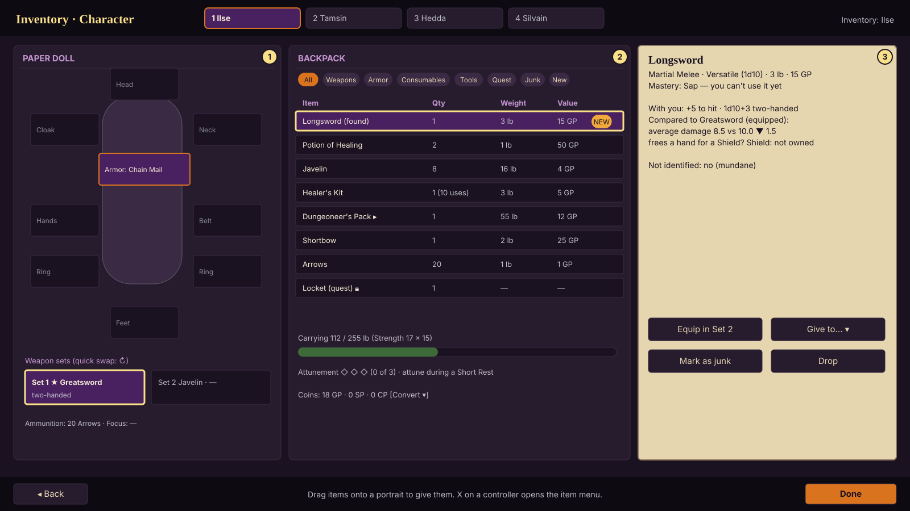
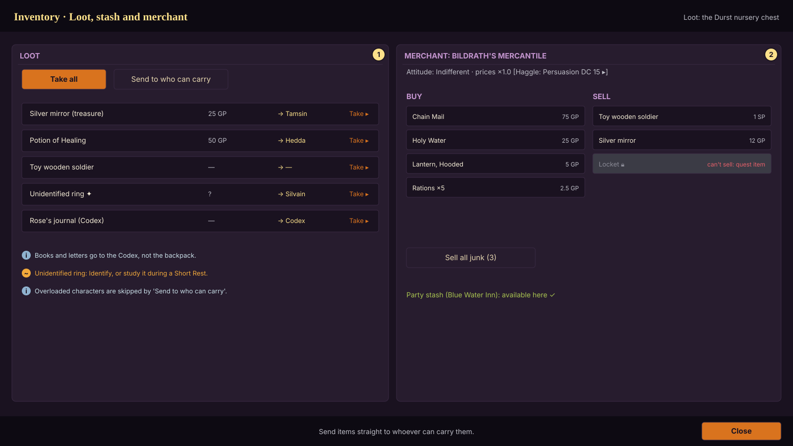

# Inventory (core flow 3 of 4)

Status: **approved by the owner 2026-10-06 ("Looks good")** · Owner role: Character and Party UX · Plan §5.6 "Inventory"
Engine: `Character.inventory / equip / unequip / add_item / carried_weight / carrying_capacity / attacks()`
(Phase 1), `Gear` helpers, item data in `data/items` (183 items). Paper doll slots beyond armor and hands, the
stash, attunement and merchants are Phase 3 and 4 engine work; this spec fixes their screens now.

## What this screen must do

- One inventory per character, plus a party stash. Things go into the stash from anywhere (the item card's Send to
  the stash, the loot window's Stash and All to the stash) and come out only at a safe place: an inn, a home,
  Argynvostholt once reclaimed (owner, 2026-10-07). An item keeps its own state there (charges, identified, a junk
  mark). Currency in cp, sp, ep, gp, pp with conversion.
- Show what every item does *for this character*, compare it with what's equipped, and never let carrying,
  attunement or quest items surprise the player.
- Fast with mouse, keyboard and controller, and smooth with 300+ items (plan's performance budget).

## Character inventory (`inv_01_character`)

- **Paper doll**: head, cloak, neck, armor, hands, belt, two rings, feet; **weapon sets** (main hand + off hand,
  two sets with a quick swap ↻); ammunition and spellcasting focus slots. Equipping armor shows the new AC on the
  slot; armor without training warns on its item card and again in the note the moment it goes on (Disadvantage on
  Str/Dex rolls, no spellcasting; owner report 2026-10-18), and the combat Spell tab names it when it shuts a caster's spells.
  Built (U11, 2026-10-07; in the shape of a person 2026-10-09, owner: the items "in the place where they would be
  equipped"): every slot sits on a drawn figure where it's worn: the head, the eyes beside it and any Ioun Stones
  orbiting it (two shown, then "+n more"), the neck under it, a cloak and a robe at the shoulders, armor on the
  chest, bracers and gloves on the forearms, a weapon in each hand (weapon set I) with set II (stowed in the pack,
  `Character.weapon_set_2`) under it and ↻ Swap outside fights (in one, a character attacks only with sets I and II,
  and Swap weapons or an attack with set II's weapon takes that set in hand: deviations.md, Weapon sets), a ring by
  each hand, the belt at the waist, the **quiver** (`ammo`: a stack of ammunition) and the **focus** (a spellcasting
  focus or a component pouch) at the hips, and boots at the feet (`InventoryScreen.DOLL_AT`). The portrait, name,
  Armor Class shield and three attunement lozenges head the column; four **quick slots** (`Character.quick_slots`)
  whose items the fight's hotbar also shows on its Common tab, and the load, sit under the figure. A slot takes only
  what fits (armor, a weapon or a held wand, rod or staff, a Shield or Light weapon in the off hand, a worn item in
  its own slot, ammunition in the quiver, a focus in the focus slot) and lights green while a drag it takes hovers
  over it. The quiver and the focus change no rules (`Gear.carry_slot`): ammunition is drawn by its kind, and a
  focus is assumed carried (deviations.md, Material components and focuses). A new hero starts with the ammunition
  their weapons shoot in the quiver and a focus in the focus slot (`Character.seed_doll`); an older save fills them
  once as it loads.
- **Drag and drop**: pack items onto a doll slot, set II or a quick slot; anything onto another character's chip
  (the whole stack, that very item with its own charges) or the stash; slots, set II, quick slots and (at a safe
  place) the stash back into the pack. Right-click a tile for its actions (the first is what a double-click does):
  take off, wear or hold, set II, keep to hand, give, send to the stash, junk, split the stack in two, drop one. The
  card's How many stepper sets how many of a stack Give, Send to the stash and Split off move.
- **Backpack**: a list, always (owner 2026-10-09; the icon grid and the view switch are gone): a row per stack with its
  icon, name and count, its marks (New, Junk, Equipped, Readied for the quiver, Focus, Quick, Quest, Attuned, its
  rarity, charges) and weight; filters (All, Weapons, Armor, Potions, Scrolls, Consumables, Magic, Gear, Quest), the New, Junk
  and Attuned marks as toggles with their counts, sort by name, weight, value or newest, and a search box (every word
  must appear in the item's name, kind or rarity); columns Item / Qty / Weight / Value; packs open as containers (▸).
  **Potions**, **Scrolls** and **Quest** items have tabs of their own (owner 2026-10-17, Scrolls 2026-10-18): a potion
  is no longer under Consumables (anything else used up, a Scroll of Protection too), **Scrolls** keeps the Spell
  Scrolls of every level (`InventoryScreen.is_spell_scroll`: the bare Spell Scroll, the two that only say a level, and
  one for each spell, found or bought), and a quest item is not Gear (the Sunsword is under Weapons and Magic as well).
  A magic item's picture has a box in the colour of its rarity (common, uncommon, rare, very rare, legendary,
  artifact: `ItemTile.rarity_colour`, the same colours as the item notices and the shop), never the row round it;
  the stash's rows and the doll's tiles do the same (owner 2026-10-18). **Rarity** chips under the search box keep
  only magic items of the chosen rarities (any number of the six, in their colours; one nothing in the pack has is
  greyed out) and combine with the tab, the marks and the search. **Attuned** keeps what
  the character is attuned to (`InventoryScreen.is_attuned`: an item that needs attunement and works for them, so
  with the attunement limit lifted it lists every worn magic item that would have needed it). Quest items (and the
  three treasures) show Quest and can't be sold, stashed, dropped or marked as junk. **New** is what arrived since the
  character's page was last opened (finds, purchases, gifts; never starting gear). **Junk** is the player's mark,
  kept when the item changes hands; the Junk view totals its weight and value.
- **Carrying**: carried / capacity with the breakdown (Strength × 15, × size; Powerful Build counts one size larger)
  and the optional DMG encumbrance thresholds if the owner turns them on.
- **Attunement**: three slots; attuning and ending an attunement are instant, from the item's row (owner house rule,
  2026-10-07: no Short Rest needed; docs/rules/deviations.md).
- **Item card** (focus any item): all properties, mastery (and whether the character can use it), what it does for
  this character ("+5 to hit, 1d10+3 two-handed"), a comparison with the equipped item (average damage, AC, weight)
  with ▲/▼ and words, unidentified/cursed state, charges, and actions: Equip in Set 1/2, Give to…, Mark as junk,
  Drop, Use (consumables: a Potion of Healing is a Bonus Action in combat), Split stack.

## Loot, stash and merchant (`inv_02_loot_and_merchant`)

- **Loot window**: Take all, Take one, Take gold (the coins alone, into the party purse), or **Send to who can carry** (skips overloaded characters and says so).
  Books, letters and notes go to the **Codex**, not the backpack. Unidentified items say how to identify them
  (Identify, or study during a Short Rest per 2024 rules).
- **Party transfer**: drag an item onto another portrait (or "Give to…"); the receiving character's capacity is
  checked first.
- **Merchant**: Buy and Sell columns; prices change with the NPC's attitude (Hostile/Indifferent/Friendly, 2024
  Influence) and an optional Persuasion haggle that rolls in the open; "Sell all junk" sells everything the party
  marked as junk that this merchant buys, from every pack at once (equipped things stay); quest items can't be sold.
  The Sell side has the backpack's filter tabs (All, Weapons, Armor, Potions, Scrolls, Consumables, Magic, Gear, Quest; LB/RB on a pad) and
  **Only what <merchant> buys**, on at first, which hides what that merchant won't take and says how many it hid.
  Both choices hold at every counter until the game is closed (owner, 2026-10-13). The Sell rows and the wares have
  the rarity box round their pictures as in the backpack, and the wares' tabs split Potions and Scrolls off Consumables the same way.
- **Stash** shows under the backpack everywhere; its Take buttons work only at safe places.

## Combat hooks (Phase 2)

Quick slots for consumables, tracked light durations (torches 1 hour, lamps 6 hours per flask), ammunition
recovery after combat (half the spent pieces), and the wizard's spellbook as a real item (copying a spell costs
50 GP and 2 hours per level).

## States

| State | What the player sees |
|---|---|
| Empty backpack | "Nothing here yet" with the filters still visible |
| Overloaded | capacity bar red with the number over; Speed effect explained; "Send to…" suggestions |
| Item can't be used well | ~ on the card: "Not proficient: no Proficiency Bonus on attacks" |
| Quest item | 🔒 and "Can't sell or drop: needed for <quest>" |
| Unidentified | ✦ and how to identify; properties hidden |
| Attunement full | the fourth item says which one to end first |
| Controller | D-pad moves in the grid, A equips/uses, X opens the item menu, Y explains, LB/RB filters, LT/RT character |

## Acceptance

- Engine (Phase 1, passing): starting equipment for every class and background, auto-equip, AC from armor and
  shields, Strength penalty, Stealth Disadvantage, weapon profiles, carrying capacity by size.
- Phase 3: 300-item inventory scrolls and filters without a frame over 16 ms; drag between characters; loot to
  whoever can carry; quest items locked.
